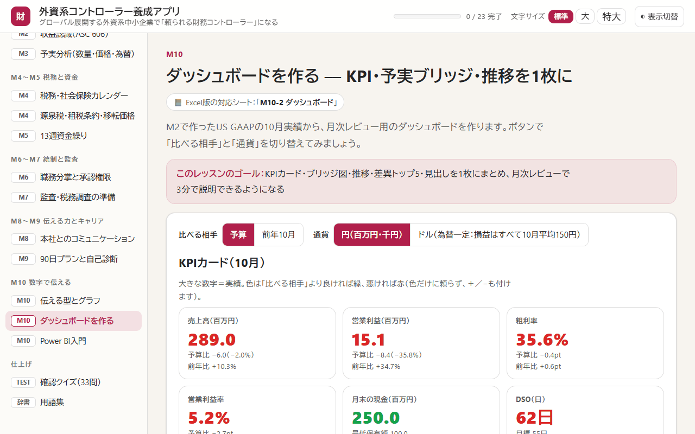
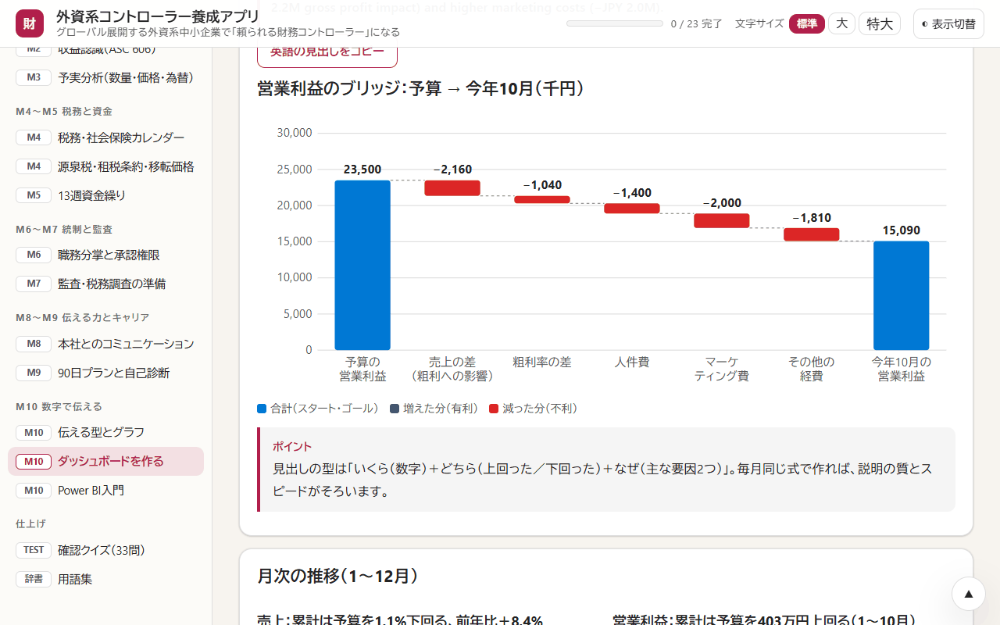

# 外資系コントローラー養成ツール

グローバルに展開する外資系企業の日本法人で、「頼られる財務コントローラー」になるための実践トレーニングです。月次決算、本社への英語での報告、日本の税務、資金繰り、内部統制、監査対応、数字で伝える力（グラフ・ダッシュボード・Power BI）までを、架空の会社のコントローラーとして学びます。

> **English summary:** A practical Japanese course for aspiring financial controllers at the Japanese subsidiary of a global company: month-end close, US GAAP reporting to headquarters (with English phrases), Japanese tax and social insurance, 13-week cash flow, internal controls, audits, and data storytelling with dashboards and Power BI. Includes a single-file offline HTML app, a 23-sheet self-checking Excel workbook, and a Power BI Desktop exercise with practice CSV data. All companies, figures and exchange rates are fictional.

  

| 項目 | 内容 |
|---|---|
| 学習時間の目安 | 約9.5時間 |
| 学習アプリ | 全23ページ（レッスン20、確認クイズ33問、用語集61語・英語⇔日本語） |
| Excel ワークブック | 23シート |
| Power BI の実習 | 手順書（9ページ）と練習データ（CSV 6ファイル）。所要時間は60〜90分 |

## 目次

- [この教材でわかること](#この教材でわかること)
- [すぐに始める](#すぐに始める)
- [収録ファイル](#収録ファイル)
- [ケース会社（架空）](#ケース会社架空)
- [カリキュラム](#カリキュラム)
- [学び方](#学び方)
- [Power BI の実習](#power-bi-の実習)
- [動作環境](#動作環境)
- [よくある質問](#よくある質問)
- [注意事項](#注意事項)
- [利用について](#利用について)
- [このシリーズのほかの教材](#このシリーズのほかの教材)

## この教材でわかること

- 月次決算の締めのカレンダー、発生主義と未払い計上、増減分析（Flux）
- 日本基準・US GAAP・IFRS のちがいと、本社報告のための GAAP 調整、収益認識（ASC 606）
- 予算と実績の差を「数量・価格・為替」に分けて、英語で説明する方法
- 税務・社会保険のカレンダー、源泉税・租税条約・移転価格、13週資金繰り
- 職務分掌と承認権限、監査・税務調査の準備、本社とのコミュニケーション（英語フレーズ）
- 伝わるグラフとダッシュボードの作り方、Power BI の基本

**こんな人に向いています**

- 外資系企業の経理・財務で働いている人、これから働きたい人
- 日本基準の経理経験はあり、US GAAP での本社報告や英語での説明に自信をつけたい人
- 経理の数字を、グラフやダッシュボードで伝えられるようになりたい人

## すぐに始める

インストールもアカウント登録もいりません（Power BI の実習だけ、Power BI Desktop が必要です）。

1. このページの上にある緑色の **［Code］** ボタン → **［Download ZIP］** で、ファイル一式をダウンロードします。
2. ダウンロードした ZIP ファイルを展開します（Windows は右クリック → **［すべて展開］**、Mac はダブルクリック）。
3. **`外資系コントローラー養成アプリ.html`** をダブルクリックすると、ブラウザで学習アプリが開きます。
4. **`外資系コントローラー養成ワークブック.xlsx`** を Excel で開きます。画面の上に「保護ビュー」の帯が出たら、**［編集を有効にする］** を押してください（押さないと答えを入力できません）。

> [!NOTE]
> GitHub の画面で `.html` ファイルをクリックすると、アプリではなく中身のコードが表示されます。アプリとして使うときは、ダウンロードしてから開いてください。1つのファイルだけ必要なときは、ファイルを開いて右上の **［Download raw file］**（下向き矢印のボタン）を押します。

## 収録ファイル

| ファイル | 内容 |
|---|---|
| [外資系コントローラー養成アプリ.html](外資系コントローラー養成アプリ.html) | 学習アプリ。全23ページ（レッスン20、確認クイズ33問、用語集61語）。各レッスンの最後に確認問題があります |
| [外資系コントローラー養成ワークブック.xlsx](外資系コントローラー養成ワークブック.xlsx) | 実践ワークブック（23シート）。黄色いセルに答えを入れると、すぐに○×が出ます（確認テスト33問を含め、判定は140か所以上） |
| [Power BI練習_手順書.docx](Power%20BI練習_手順書.docx) | Power BI Desktop で、予算と実績の月次ダッシュボードを作る手順書（9ページ） |
| [PowerBI練習データ/](PowerBI練習データ/) | 手順書で使う練習用の CSV（6ファイル：勘定科目・日付・部門・予算・実績・KPI） |

## ケース会社（架空）

ルミナ・システムズ・ジャパン株式会社。米国の親会社の100%子会社で、従業員45名、12月決算です。日本の帳簿は日本基準でつけ、本社には US GAAP・米ドルで報告します。あなたは、この会社のコントローラーです。

## カリキュラム

| モジュール | レッスン |
|---|---|
| はじめに | コントローラーの仕事、ケース会社 |
| M1 月次決算 | 締めのカレンダー、発生主義と未払い計上、増減分析（Flux） |
| M2〜M3 報告と分析 | 3つの会計基準（日本基準・US GAAP・IFRS）、同じ取引を3つの基準で、本社報告・GAAP調整、収益認識（ASC 606）、予実分析（数量・価格・為替） |
| M4〜M5 税務と資金 | 税務・社会保険カレンダー、源泉税・租税条約・移転価格、13週資金繰り |
| M6〜M7 統制と監査 | 職務分掌と承認権限、監査・税務調査の準備 |
| M8〜M9 伝える力とキャリア | 本社とのコミュニケーション（英語フレーズ）、90日プランと自己診断 |
| M10 数字で伝える | 伝える型とグラフ、ダッシュボードを作る、Power BI 入門 |
| 仕上げ | 確認クイズ（33問）、用語集 |

画面の例：営業利益のブリッジ図（予算 → 実績）

 

  

## 学び方

1. 「コントローラーの仕事」と「ケース会社」で全体をつかみ、M1 から順に進めます。
2. 各レッスンの最後の確認問題で理解を確かめ、「完了して次へ」で進み具合を記録します。最後の確認クイズでは、まちがえた問題の振り返りと、まちがえた問題だけの解き直しができます。
3. 各レッスンの見出しの下に、Excel の対応シート名が表示されます。Excel の黄色いセルに答えを入れると、すぐに○×が出ます。答えは、シート上部の黄色いセルで「表示する」を選ぶと見られます。各シートの3行目にある「≡ 目次」「◀ 前」「次 ▶」で順番に移動できます。
4. M10 まで進んだら、[Power BI の実習](#power-bi-の実習)で、同じ数字のダッシュボードを Power BI Desktop で作ります。

> [!TIP]
> 学習アプリは、文字の大きさ（標準・大・特大）と、明るい表示・暗い表示を、画面右上で切り替えられます。

## Power BI の実習

手順書（[Power BI練習_手順書.docx](Power%20BI練習_手順書.docx)）は、ワークブックの「M10-3 Power BI入門」の付録です。所要時間は60〜90分、単位は千円（US GAAP）です。

- 6つの CSV を取り込み、スター型のデータモデルを作ります（Power Query・リレーションシップ）。
- DAX で、予実差・前年比・累計のメジャーを作ります。
- 1ページのダッシュボードを作り、Excel（M10-2）の数字と照合（Tie-out）します。
- 共有する前の統制（行レベルセキュリティ・単位と基準の表示・照合の記録）を体験します。

準備するもの：

- **Power BI Desktop**（無料・Windows 用）。Microsoft Store か Microsoft の公式サイトからインストールします。
- [PowerBI練習データ/](PowerBI練習データ/) の6つの CSV（UTF-8）。フォルダごと、同じ場所に置いたまま使います。

## 動作環境

| ファイル | 必要なもの | 補足 |
|---|---|---|
| 学習アプリ（`.html`） | Microsoft Edge、Google Chrome などのブラウザ | 1つのファイルで動き、外部のサーバーとは通信しません。進み具合は、使っているブラウザの中にだけ保存されます |
| ワークブック（`.xlsx`） | Microsoft Excel | マクロは使っていません |
| 手順書（`.docx`）と練習データ（`.csv`） | Word など .docx を開けるソフト、Power BI Desktop（Windows） | Power BI Desktop はライセンスなしで使えます |

2026年11月に、Windows 11 の Microsoft Edge で全ページの表示を、Microsoft 365 の Excel で全シートの計算（エラーが出ないこと）を確かめています。

## よくある質問

GitHub で HTML ファイルを開くと、文字（コード）ばかり表示されます

 
GitHub は HTML ファイルをアプリとして動かさず、中身のコードを表示します。<a href="#すぐに始める">すぐに始める</a>の手順でダウンロードしてから、ブラウザで開いてください。

Excel で答えを入力できません

 
インターネットから入手したファイルは「保護ビュー」（読み取り専用）で開きます。画面の上の帯にある［編集を有効にする］を押すと、入力できるようになります。

Mac で Power BI の実習はできますか？

 
Power BI Desktop は Windows 用のアプリのため、Power BI の実習には Windows の PC が必要です（学習アプリとワークブックの動作確認も、Windows で行っています）。

進み具合はどこに保存されますか？

 
アプリを開いたブラウザの中（localStorage）にだけ保存され、外部には送られません。別のパソコンや別のブラウザには引き継がれません。記録を消したいときは、ブラウザの閲覧データ（サイトデータ）を削除してください。

## 注意事項

- 学習のための教材です。会社・数字・為替レートはすべて架空です。
- 税務・社会保険の日程や制度は、2026年10月時点の一般的な内容です。実務では、最新の情報を確かめ、税理士・社会保険労務士などの専門家に相談してください。

## 利用について

- 個人の学習や、勉強会・研修の教材として、自由に使ってください。自分用に内容を直して使ってもかまいません。
- ファイルを販売したり、有料の講座でそのまま配ったりする場合は、先に [Issues](https://github.com/rebelnaoto7/Financial-Controller-Leaning-Tool/issues) でご相談ください。
- 正確さには注意して作っていますが、誤りがあるかもしれません。見つけたときは [Issues](https://github.com/rebelnaoto7/Financial-Controller-Leaning-Tool/issues) で教えてください。

Microsoft、Windows、Microsoft 365、Microsoft Edge、Excel、Word、Power BI、Copilot は、Microsoft グループの商標です。この教材は、Microsoft が提供・承認したものではありません。そのほかの会社名・サービス名・製品名は、それぞれの会社の商標または登録商標です。

## このシリーズのほかの教材

| 教材 | ひとことで |
|---|---|
| [はじめての連結決算](https://github.com/rebelnaoto7/Consolidated-financial-statements-learning-tool) | 架空の10か国グループで、連結決算のしくみを学ぶ |
| [M&Aアドバイザー養成ツール](https://github.com/rebelnaoto7/MA-advisor-learning-tool) | 売り手のFAとして、企業価値の評価・交渉・DD・契約・PMI を学ぶ |
| [日本株・米国株 分析ラーニングツール](https://github.com/rebelnaoto7/stock-analysis-learning-tool) | ファンダメンタル分析とテクニカル分析を、初級から超上級まで |
| [スモールビジネス起業・経営ツール](https://github.com/rebelnaoto7/small-business-starts-and-management-tool) | 小さなお店の開業から経営まで。自分の事業に使える計画用の Excel つき |
| [はじめてのセキュリティ入門](https://github.com/rebelnaoto7/cybersecurity-learningtool) | サイバー攻撃の手口と守り方を、試しながら学ぶ |
| [はじめての Power BI マーケティング分析](https://github.com/rebelnaoto7/Power-BI-and-Marketing) | マーケティングの数字の読み方と、Power BI でのダッシュボード作り |
